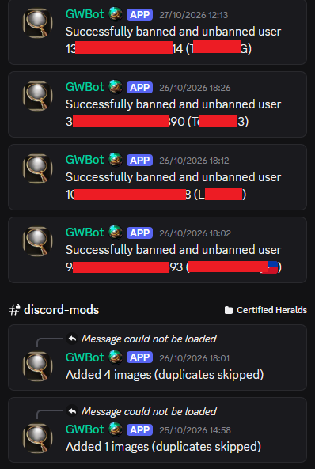
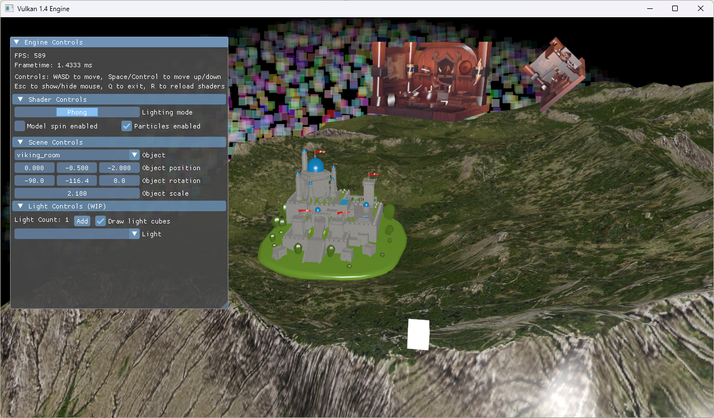
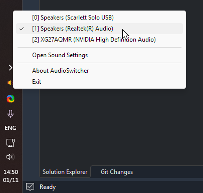
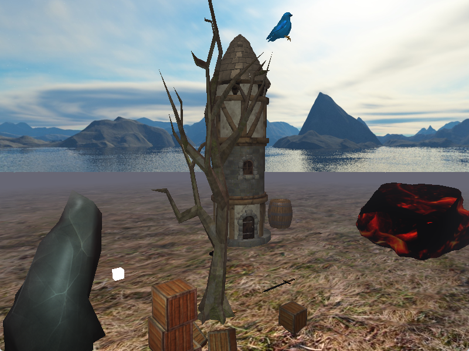
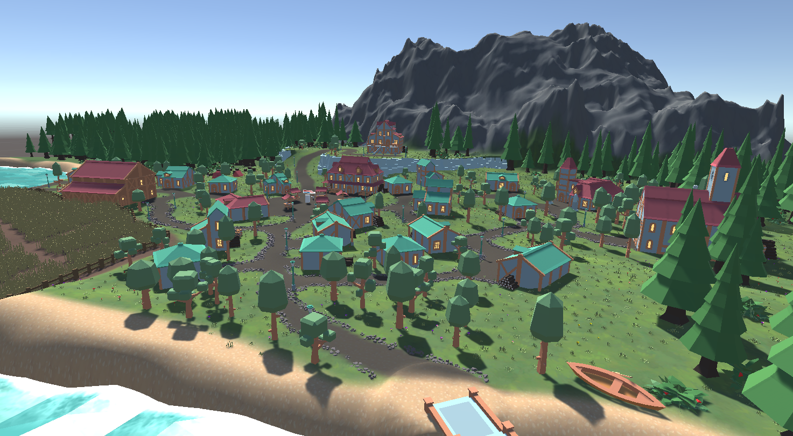

# Some of my projects - click on the title to go to the GitHub page for the project

## [GWBot](github.com/gwtjxyz/GWBot)

Discord moderation bot that scans messages for malicious images using hash comparisons. Used actively by a public
community server with over 100k total users and thousands of weekly visitors.

## [Vulkan Rendering Engine (WIP)](https://github.com/gwtjxyz/VulkanRenderEngine)

Under active development; project to learn a modern graphics API and various rendering techniques while trying to use best modern practices when applicable.
Currently supports OBJ and GLTF file formats, basic lighting models, HLSL shaders, bindless rendering, shader hot reloading,
basic particle compute display, and adding/removing arbitrary amounts of lights to the scene. Built to run cross-platform
on Windows and Mac, with Mac's hardware constraints in mind.

## [AudioSwitcher](https://github.com/gwtjxyz/AudioSwitcher)

Simple, minimal and lightweight Win32 application that creates a tray icon you can use to switch your audio devices in one click
and saves you the hassle of having to use Windows 11's slow and clunky built-in UI for it or worry about not hearing your
friends over voice chat because something got stuck as a selected communication device. Bonus feature of a one-click
navigation to the control panel version of sound settings because Win11 puts way too much effort into hiding it from you.

## [OpenGL university project](https://github.com/gwtjxyz/pgr-semestral-project)

Bad code, decent visual showcase of some basic rendering techniques. Terrain is generated using Perlin noise.

## [Magitech](https://mravenisko.itch.io/magitech)

Unity team project. I mostly worked on the dialogue system, and I also wrote all the dialogue.

## [Bomberman](https://github.com/gwtjxyz/bomberman)

Very old project, probably not very good code. Can play
Bomberman in your terminal, either local multiplayer or single-player vs AI. Includes power-ups and a scoring system. Built on ncurses so need to run on Linux/Mac or through WSL on Windows.
